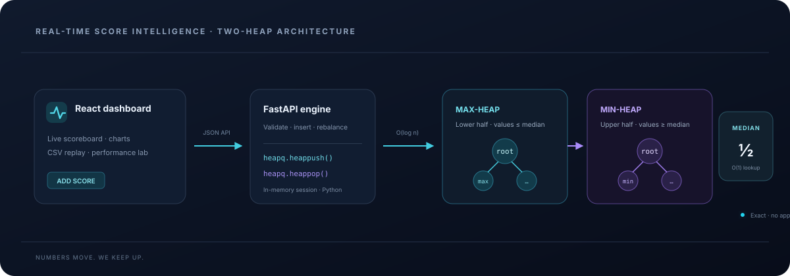

# MEDIANFLOW

### Real-time score intelligence for streams that never stop

**Numbers move. We keep up.**

[](https://react.dev/)
[](https://vite.dev/)
[](https://fastapi.tiangolo.com/)
[](https://pytest.org/)
[](#3-algorithm--engineering-principles)

MEDIANFLOW is an interactive score-stream dashboard that calculates the exact running median as new values arrive. A two-heap engine keeps insertion efficient while the dashboard makes the stream, heap balance, and median movement visible.

The project is a local-first hackathon application. Its session data is held in memory and is cleared when the API process restarts; it is not a persistent or multi-user service.

**Quick links:** [Quickstart](#4-quickstart) · [API reference](#7-api-reference) · [Verification](#4-quickstart-verify)

---

## Project Gallery



*Scores move from the dashboard through the API into balanced heaps; the median is always ready at the roots.*

---

## 1. System Architecture

MEDIANFLOW uses a React single-page application and a Python API. The browser requests live session data and sends score insertions to FastAPI; the backend owns the authoritative heaps and median.

### Runtime flow

1. Vite serves the React application and its styles and assets.
2. The dashboard requests session metrics from the FastAPI service.
3. Each score is validated as a signed 32-bit integer and inserted into the two-heap structure.
4. The dashboard updates its charts, history, and metrics without a page reload.
5. Heap contents are returned on demand for the heap visualizer, keeping normal insertion responses lightweight.

### Main components

| Component | Responsibility |
| --- | --- |
| `src/App.jsx` | Dashboard navigation, score entry, simulator, CSV replay, analytics, charts, and page views |
| `src/styles.css` | Responsive dark-theme interface and component styling |
| `backend/median.py` | Two-heap data structure, running median, bounded histories, and heap inspection |
| `backend/main.py` | FastAPI routes for scores, session state, CSV uploads, and benchmarks |
| `tests/` | Randomized median checks and API behavior tests |

## 2. Features

- **Overview dashboard:** Live totals, current median, heap sizes, insertion latency, stream status, median trend, activity, and recent scores.
- **Live scoreboard:** Insert signed 32-bit integers, including negative values, duplicates, zero, and integer extremes.
- **Automatic stream:** Generate random scores with configurable minimum and maximum values and insertion intervals. Start, pause, resume, or stop the stream.
- **Heap visualizer:** Inspect the max-heap containing the lower half and the min-heap containing the upper half.
- **Analytics:** Review median movement, recent score polarity, and recent insertions.
- **CSV stream replay:** Validate a score column and replay its values into the live session at a selected pace.
- **Performance lab:** Benchmark generated streams up to 100,000 values and verify the resulting median against a sorted reference.
- **Algorithm guide:** Learn the balancing invariants and the insertion, median-lookup, and storage costs.
- **Responsive navigation:** Use the sidebar on desktop or the navigation drawer on smaller screens.

## 3. Algorithm & Engineering Principles

MEDIANFLOW partitions incoming values between two heaps:

- The **lower half** is stored in a max-heap.
- The **upper half** is stored in a min-heap.
- The lower heap may contain one more value than the upper heap; their sizes never differ by more than one.
- Every value in the lower heap is less than or equal to every value in the upper heap.

For an odd number of scores, the root of the larger heap is the median. For an even number, the median is the arithmetic mean of both roots.

| Operation | Complexity |
| --- | --- |
| Insert a score | O(log n) |
| Read the current median | O(1) |
| Store the stream | O(n) |

The API keeps the session in memory. Median and activity charts retain a bounded recent history, while the score counter and heaps represent the whole current session.

## 4. Quickstart

### Requirements

- Python 3.10+
- Node.js 18+
- A modern browser

### Run locally

From the repository root, open two terminals.

**Terminal 1 — API**

```powershell
python -m venv .venv
.\.venv\Scripts\Activate.ps1
pip install -r requirements.txt
python -m uvicorn backend.main:app --reload
```

**Terminal 2 — web application**

```powershell
npm install
npm run dev
```

Open **http://localhost:5173**. The API runs at **http://localhost:8000** and its interactive documentation is available at **http://localhost:8000/docs**.

The frontend uses `http://localhost:8000` by default. To point it at another API URL, set `VITE_API_URL` before starting Vite.

### Verify

```powershell
python -m pytest
npm run build
```

## 5. Deploy

The frontend and API are separate services; deploying only the frontend will leave score submission unavailable.

### Deploy the API to Render

1. Create a Render **Blueprint** from this repository. Render will use [`render.yaml`](render.yaml) to build and start the FastAPI service.
2. Set the service's `CORS_ORIGINS` environment variable to the exact deployed frontend origin, such as `https://your-app.vercel.app` (no trailing slash). Add additional comma-separated origins if needed.
3. Deploy the service and verify `https://YOUR-API.onrender.com/api/health` returns `{"status":"ok"}`.

### Deploy the frontend to Vercel

1. Import this repository into Vercel.
2. Set the `VITE_API_URL` environment variable to the API base URL, such as `https://YOUR-API.onrender.com` (no `/api` suffix).
3. Redeploy after setting the variable. Vite embeds it into the production frontend at build time.

If the frontend URL or CORS setting changes, update `CORS_ORIGINS` on Render and redeploy the API. Production score requests will show a configuration-specific message if the API URL is missing or unreachable.

## 6. A Typical Session

1. Start the API and frontend, then open the dashboard.
2. Add scores manually or configure and start the automatic stream.
3. Watch the running median and heap balance update as values arrive.
4. Inspect the heap arrays, analytics, or replay a CSV score history.
5. Run a performance benchmark to compare the engine’s result with a sorted reference.
6. Reset the session from the sidebar when you want to start fresh.

## 7. API Reference

| Method | Route | Description |
| --- | --- | --- |
| `GET` | `/api/health` | Check API availability |
| `GET` | `/api/state` | Read session metrics and recent histories |
| `GET` | `/api/heaps` | Retrieve heap arrays for visualization |
| `POST` | `/api/scores` | Insert a score, for example `{"value": 42}` |
| `DELETE` | `/api/session` | Clear the in-memory session |
| `POST` | `/api/csv` | Validate and add a CSV whose first column contains scores |
| `POST` | `/api/benchmark` | Benchmark generated data, for example `{"count": 10000}` |

The benchmark accepts a count from 1 to 100,000 and returns elapsed time, throughput, the calculated median, and whether it matched the sorted reference.

## 8. Data & Limitations

- Scores must be signed 32-bit integers.
- The CSV API expects UTF-8 CSV with scores in the first column; a `score`, `value`, or `scores` header is accepted.
- The CSV replay screen validates the file before sending values individually through the live score endpoint.
- Session data is in memory only. Restarting the backend clears it.
- The app has no account system, database, or durable storage.

## 9. Project Layout

```text
.
├── backend/
│   ├── main.py          # FastAPI application and routes
│   └── median.py        # Two-heap running median
├── src/
│   ├── App.jsx          # React application
│   ├── main.jsx         # Frontend entry point
│   └── styles.css       # Responsive visual design
├── tests/
│   ├── test_api.py      # API behavior
│   └── test_median.py   # Randomized and edge-case correctness
├── index.html
├── package.json
└── requirements.txt
```

## 10. Technology

- **Frontend:** React, Vite, Tailwind CSS, Framer Motion, Lucide React, and Recharts
- **Backend:** Python, FastAPI, Pydantic, and `heapq`
- **Testing:** Pytest, randomized reference comparisons, and API tests
